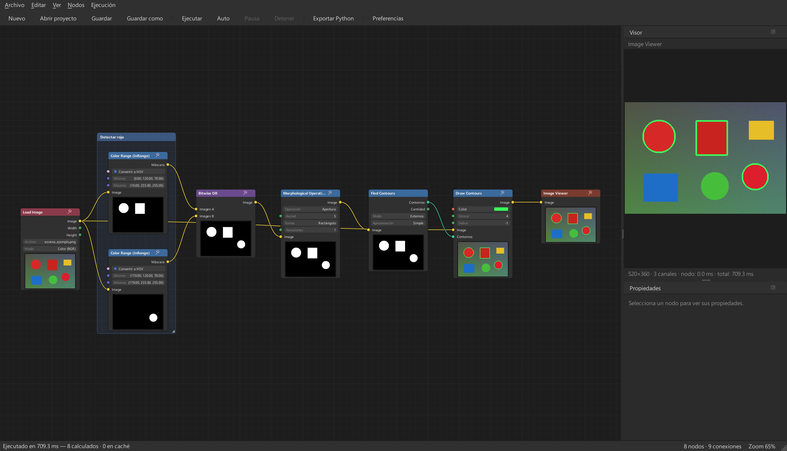
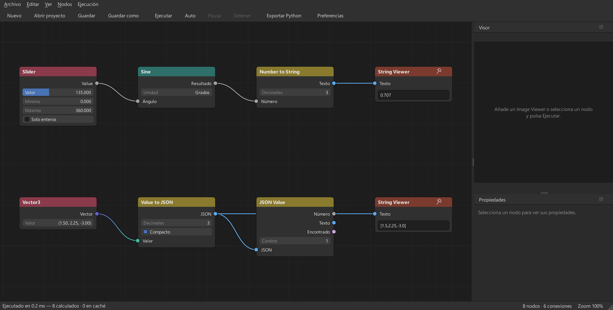
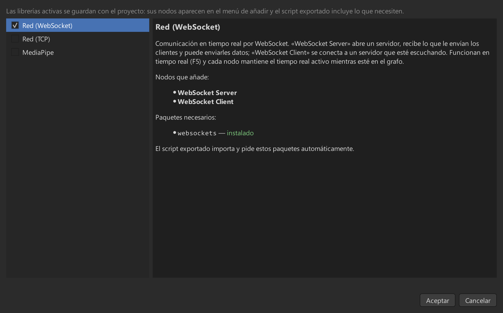
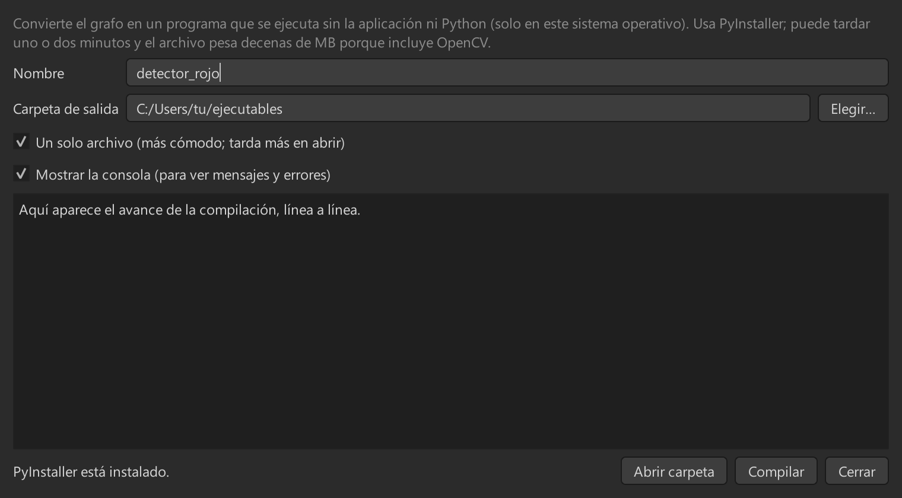

<div align="center">

# Palantir Nodes

**Editor visual de nodos para procesar imágenes y video con Python y OpenCV, al estilo de Blender.**

Conecta nodos, ve el resultado al instante —también en tiempo real con tu webcam— y llévalo a un
script de Python o a un ejecutable.

[](LICENSE)




</div>

---

## ¿Qué es?

Palantir Nodes convierte el procesamiento de imágenes en algo que **se ve y se toca**. En lugar de
escribir un script y ejecutarlo para ver qué pasó, armas un grafo de nodos —cargar imagen, filtrar,
umbralizar, encontrar contornos, dibujar— y cada nodo muestra una miniatura de su resultado. Cambia
un valor y todo se recalcula al momento.

Es una herramienta para **aprender y experimentar con visión por computador**, para **prototipar**
un flujo antes de programarlo, y para **generar el código** una vez que funciona: el mismo grafo se
exporta a un script de Python independiente o se compila a un programa que corre sin la aplicación.

## Características

**Un editor cómodo**
- Tema oscuro, cuadrícula, zoom y desplazamiento; conexiones validadas por tipo (no se pueden
  crear ciclos ni conectar tipos incompatibles) y deshacer/rehacer de todo.
- **Edición dentro del nodo:** clic para escribir, arrastrar para ajustar números, deslizadores,
  listas, selector de color. Cada nodo con imagen muestra su **miniatura**.
- **Arrastra una conexión a un espacio vacío** y se abre un buscador filtrado por los nodos que
  pueden conectarse, como en Blender.
- **Todo parámetro numérico se puede conectar a otro nodo**, o escribirse a mano.
- **Frames** para agrupar nodos, **chincheta** para fijar el visor en un nodo, **proyectos JSON**.

**Un motor fiable**
- Solo se recalculan los nodos afectados por un cambio (caché por contenido).
- **Un nodo que falla no detiene el resto:** se marca en rojo con el motivo, y los que dependen
  de él en ámbar. La interfaz nunca se bloquea: el cálculo corre en otro hilo.

**Tiempo real**
- **Webcam y video** a su ritmo, con pausa, detener y FPS en pantalla. Los cambios en el grafo se
  aplican en vivo.

**De la idea al programa**
- **Exportar a Python:** un `.py` independiente que da el mismo resultado que el editor.
- **Compilar a ejecutable:** un `.exe` que funciona sin la aplicación ni Python.

**Ampliable**
- **Nodos personalizados:** escribe una función de Python y se convierte en nodo (entradas y salidas
  detectadas solas).
- **Librerías opcionales por proyecto:** red por WebSocket y TCP, y detección de manos, cuerpo y
  rostros con MediaPipe.

## Capturas

<table>
<tr>
<td width="50%"><b>Valores, texto y JSON</b><br>Deslizador, trigonometría, conversiones y lectura de resultados en nodos.<br></td>
<td width="50%"><b>Nodos personalizados</b><br>Una función de Python se convierte en nodo; el panel muestra lo que detecta.<br></td>
</tr>
<tr>
<td width="50%"><b>Librerías por proyecto</b><br>Activa solo lo que necesitas; la aplicación indica si falta un paquete y lo instala.<br></td>
<td width="50%"><b>Compilar a ejecutable</b><br>El grafo se convierte en un programa independiente.<br></td>
</tr>
</table>

## Instalación

Necesitas **Python 3.12 o superior**. Desde la carpeta del proyecto:

```bash
python -m venv .venv
.venv\Scripts\python -m pip install -e .
```

En Linux o macOS usa `.venv/bin/python` en lugar de `.venv\Scripts\python`. Para ejecutar:

```bash
.venv\Scripts\python -m palantir_nodes
```

También puedes abrir un proyecto directamente: `python -m palantir_nodes mi_proyecto.json`.

**Extras opcionales** (también se pueden instalar luego desde la propia aplicación):

| Extra | Qué añade | Comando |
|---|---|---|
| `network` | Nodos WebSocket (el de TCP no necesita nada) | `pip install -e ".[network]"` |
| `mediapipe` | Detección de manos, cuerpo y rostros | Mejor con el botón de la aplicación (ver [librerías](#librerías-opcionales)) |
| `dev` | Pruebas y revisión de código | `pip install -e ".[dev]"` |

> La aplicación está desarrollada y probada en **Windows**. El resto del código es multiplataforma
> (Qt, OpenCV, NumPy), pero en otros sistemas no se ha comprobado.

## Primeros pasos: detectar objetos rojos

El ejemplo de la captura de arriba, paso a paso. Añade nodos con **clic derecho → Añadir nodo**
(o `Shift+A`; `Ctrl+F` para buscar) y conéctalos arrastrando de una salida a una entrada:

1. **Load Image** → elige tu imagen (o usa **Webcam** para verlo en vivo).
2. Dos nodos **Color Range (InRange)** con «Convertir a HSV». El rojo está en los dos extremos del
   tono, por eso hacen falta dos: mínimo `0, 120, 70` y máximo `10, 255, 255`; y mínimo
   `170, 120, 70` y máximo `179, 255, 255`.
3. **Bitwise OR** une las dos máscaras.
4. **Morphological Operations** (Apertura) quita el ruido.
5. **Find Contours** encuentra los objetos y **Draw Contours** los dibuja sobre la imagen original.
6. **Image Viewer** muestra el resultado. Pulsa **F5** (o deja activado **Auto**).

Con una webcam o un video en el grafo, **F5** inicia el tiempo real: **F6** pausa, **Shift+F5**
detiene. Para dibujar rectángulos y centros en lugar de contornos, crea un
[nodo personalizado](docs/nodos-personalizados.md) (el ejemplo viene en esa guía).

## Nodos incluidos

**61 nodos** en 6 categorías, más los de las librerías opcionales. El catálogo completo, con
entradas, salidas y parámetros de cada uno, está en [docs/nodos.md](docs/nodos.md).

| Categoría | Ejemplos |
|---|---|
| **Entradas** | Load Image, Load Video, Webcam, Number, Integer, Boolean, Color, Vector2/3, **Slider**, **Tick** (avisa cada cierto tiempo) |
| **Imagen** | Grayscale, Gaussian/Median Blur, Threshold, Adaptive Threshold, Canny, Resize, Crop, Rotate, Flip, Color Range, Erode/Dilate, Morphological, Find/Draw Contours |
| **Conversión** | Number ↔ String, Integer ↔ Float (piso, techo, redondeo), RGB ↔ HSV, Convert Color Space, Value to JSON, JSON Value |
| **Matemáticas** | Add, Subtract, Multiply, Divide, Clamp, Map Range, Min/Max, Compare, Sine, Cosine |
| **Composición** | Blend Images, Add Weighted, Bitwise AND/OR/NOT, Mask, Merge/Split Channels |
| **Salidas** | Image Viewer, Video Viewer, Save Image, Save Video, **String Viewer** |

## Exportar y compilar

- **Exportar a Python** (`Ctrl+E`): genera un script que solo necesita OpenCV y NumPy (más lo que
  pidan las librerías que uses, indicado en su encabezado). Incluye solo lo que alimenta una
  salida, y si algo falla el error nombra el nodo. `--no-show` evita abrir ventanas y, con video,
  `--max-frames N` limita los fotogramas.
- **Compilar a ejecutable** (`Ctrl+Shift+E`): convierte el script en un programa con
  [PyInstaller](https://pyinstaller.org). El diálogo muestra el avance y, si PyInstaller no está
  instalado, pide permiso y lo instala. Comprobado con un grafo sencillo (~60 MB) y con uno de
  MediaPipe (~110 MB); el programa resultante corre sin Python ni la aplicación, **en el mismo
  sistema operativo** donde se compiló.

Las rutas de archivos (imágenes, videos) se escriben tal cual están en el grafo.

## Nodos personalizados

Escribe una función y la aplicación la convierte en un nodo. Los parámetros son las entradas, lo
que devuelve son las salidas, y los tipos se leen de las anotaciones:

```python
def separar(imagen: Image, umbral: float = 100.0) -> tuple[Image, float]:
    """Binariza por umbral y devuelve también la proporción de píxeles activos."""
    gris = cv2.cvtColor(imagen, cv2.COLOR_BGR2GRAY) if imagen.ndim == 3 else imagen
    mascara = (gris > umbral).astype(np.uint8) * 255
    cobertura = float(mascara.mean()) / 255
    return mascara, cobertura
```

Esto crea un nodo con dos entradas (`imagen` y `umbral`) y dos salidas (`mascara` y `cobertura`).
Desde el gestor (`Ctrl+Shift+N`) puedes crear, editar, duplicar y borrar nodos, elegir su categoría
y añadir carpetas con tus propios módulos. Detalles, reglas y un texto listo para pedírselo a una
IA en la [guía de nodos personalizados](docs/nodos-personalizados.md).

> ⚠ El código de un nodo se ejecuta en tu equipo y con tus permisos: no abras proyectos ni pegues
> código de origen desconocido.

## Librerías opcionales

Cada proyecto activa las que necesita en **Nodos → Librerías del proyecto…** (`Ctrl+Shift+L`). Sus
nodos aparecen en el menú de añadir y el script exportado pide los paquetes necesarios.

| Librería | Nodos | Necesita |
|---|---|---|
| **Red (WebSocket)** | WebSocket Server, WebSocket Client: recibir y enviar texto en tiempo real | `websockets` |
| **Red (TCP)** | TCP Server, TCP Client: mensajes de una línea (Arduino, ESP32, scripts…) | nada |
| **MediaPipe** | Hand/Pose Landmarks, Face Mesh, Face Detection, Landmark Point, Detections to JSON | `mediapipe` |

Si falta un paquete, el diálogo lo indica y trae el botón **Instalar paquetes que faltan**, que
usa `pip` con el mismo Python de la aplicación. MediaPipe se instala *sin dependencias* a propósito
(arrastra `opencv-contrib-python`, que pisaría el OpenCV que la aplicación ya tiene cargado), y los
modelos de cada detector se descargan la primera vez o los eliges tú.

Los resultados se pueden convertir a **JSON** (`Detections to JSON`, `Value to JSON`), leer en un
**String Viewer**, abrir con **JSON Value** o enviar por la red.

## Atajos

| Acción | Atajo |
|---|---|
| Añadir nodo / Buscar nodo | Clic derecho o `Shift+A` / `Ctrl+F` |
| Ejecutar / Pausa / Detener | `F5` / `F6` / `Shift+F5` |
| Abrir / Guardar / Guardar como | `Ctrl+O` / `Ctrl+S` / `Ctrl+Shift+S` |
| Duplicar / Copiar / Pegar | `Shift+D` / `Ctrl+C` / `Ctrl+V` |
| Eliminar | `X` o `Supr` |
| Deshacer / Rehacer | `Ctrl+Z` / `Ctrl+Shift+Z` o `Ctrl+Y` |
| Enmarcar la selección en un frame | `Ctrl+J` |
| Encuadrar todo | `Inicio` |
| Exportar a Python / Compilar | `Ctrl+E` / `Ctrl+Shift+E` |
| Nodos personalizados / Librerías | `Ctrl+Shift+N` / `Ctrl+Shift+L` |
| Preferencias | `Ctrl+,` |

## Para desarrolladores

```bash
.venv\Scripts\python -m pip install -e ".[dev]"
.venv\Scripts\python -m pytest          # 1056 pruebas
.venv\Scripts\python -m ruff check src tests tools
```

El código separa lo que depende de Qt de lo que no: el grafo, el motor, la generación de código y
la persistencia **no importan Qt** y se prueban sin interfaz; la interfaz nunca modifica el grafo
directamente, sino mediante comandos que se pueden deshacer. Un tipo de nodo nuevo es una subclase
de `NodeDefinition` con `@register_node` (o un plugin en el grupo de entry points
`palantir_nodes.nodes`). Hay más detalle en la [referencia funcional](docs/reference.md).

```
src/palantir_nodes/
├── core/          grafo, tipos de socket, validación
├── nodes/         contrato de los nodos y biblioteca incluida
├── engine/        ejecutor con caché y sesión de tiempo real
├── codegen/       generador del script exportado
├── customnodes/   nodos escritos en Python
├── libraries/     librerías opcionales (red, TCP, MediaPipe)
├── persistence/   proyectos JSON versionados
├── build/         compilación a ejecutable
└── ui/            interfaz (editor, propiedades, visor, diálogos)
```

Las capturas de `docs/images` se regeneran con `python tools/screenshots.py` y el catálogo
`docs/nodos.md` con `python tools/gen_nodes_doc.py`.

**Contribuir:** abre un *issue* o un *pull request*. Antes de enviar cambios, ejecuta las pruebas
y `ruff`. Al contribuir aceptas que tu aportación se publique bajo la misma licencia del proyecto.

## Licencia

Palantir Nodes es software libre, publicado bajo la **GNU General Public License v3.0 o
posterior** (GPL-3.0-or-later). Puedes usarlo, estudiarlo, modificarlo y redistribuirlo; las
versiones modificadas que distribuyas deben publicarse también bajo la GPL. Consulta el archivo
[LICENSE](LICENSE).

Los grafos y proyectos que crees con la aplicación son tuyos. Usa [PySide6](https://doc.qt.io/qtforpython-6/)
(LGPL), [OpenCV](https://opencv.org) (Apache 2.0), [NumPy](https://numpy.org) (BSD) y, de forma
opcional, [websockets](https://websockets.readthedocs.io) (BSD), [MediaPipe](https://ai.google.dev/edge/mediapipe)
(Apache 2.0) y [PyInstaller](https://pyinstaller.org) (GPL con excepción para los programas que genera).
