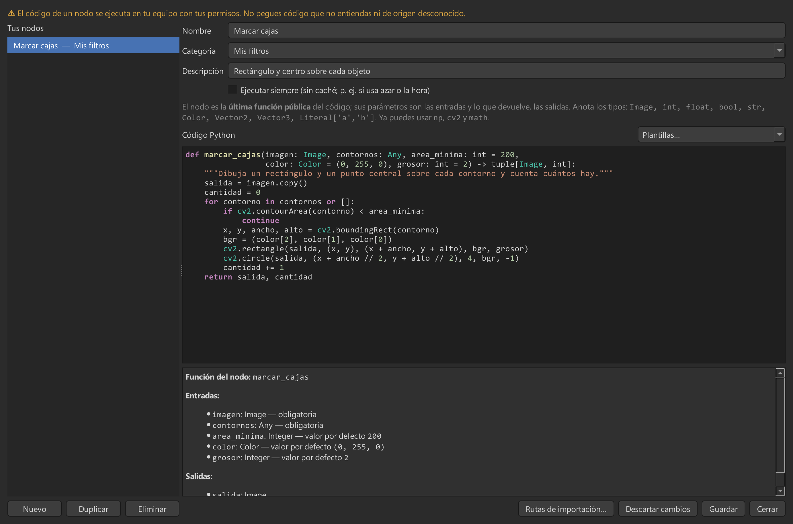

# Nodos personalizados en Python

Escribe una función de Python y la aplicación la convierte en un nodo: **los parámetros son las
entradas y lo que devuelve son las salidas**. No hay que registrar nada ni reiniciar.



## Cómo crear uno

1. **Nodos → Nodos personalizados…** (`Ctrl+Shift+N`), o «Nuevo nodo personalizado…» en el menú de
   añadir nodos.
2. Pon un **nombre**, elige o escribe una **categoría** y pega o escribe el código.
3. El panel de abajo muestra, mientras escribes, las entradas y salidas que detecta. **Guardar** lo
   registra: ya aparece en el menú de añadir y en el buscador.

Desde el mismo gestor puedes **editar, duplicar y borrar** nodos. Si el grafo abierto usa el nodo,
pide confirmación y lo adapta al nuevo código (conserva los valores por nombre y quita las
conexiones que dejaron de ser válidas).

## Un ejemplo completo

```python
def marcar_cajas(imagen: Image, contornos: Any, area_minima: int = 200,
                 color: Color = (0, 255, 0), grosor: int = 2) -> tuple[Image, int]:
    """Dibuja un rectángulo y un punto central sobre cada contorno y cuenta cuántos hay."""
    salida = imagen.copy()
    cantidad = 0
    for contorno in contornos or []:
        if cv2.contourArea(contorno) < area_minima:
            continue
        x, y, ancho, alto = cv2.boundingRect(contorno)
        bgr = (color[2], color[1], color[0])
        cv2.rectangle(salida, (x, y), (x + ancho, y + alto), bgr, grosor)
        cv2.circle(salida, (x + ancho // 2, y + alto // 2), 4, bgr, -1)
        cantidad += 1
    return salida, cantidad
```

Crea un nodo con cinco entradas (`imagen`, `contornos`, `area_minima`, `color`, `grosor`) y dos
salidas: `salida` (imagen) y `cantidad` (entero).

## Reglas

**Qué función se usa.** La **última función pública** del código (las que empiezan por `_` son
auxiliares). Puede haber `import`, constantes y funciones auxiliares; el código de nivel superior se
ejecuta una sola vez.

**Entradas (parámetros).** El tipo sale de la anotación:

| Anotación | Socket | Notas |
|---|---|---|
| `Image` (o `np.ndarray`) | Image | `Image = None` la hace opcional |
| `int`, `float`, `bool`, `str` | Integer, Float, Boolean, String | El valor por defecto es el que se ve en el nodo |
| `Color` | Color | Tupla RGB de 3 enteros 0-255 |
| `Vector2`, `Vector3` | Vector2, Vector3 | Tuplas de 2 o 3 números |
| `Any` | Any | Cualquier valor (listas de puntos, contornos…) |
| `Literal["a", "b"]` | Lista desplegable | Un parámetro con opciones fijas |

**Salidas (retorno).** `-> Image`, `-> float`, `-> str`…; para varias salidas, `-> tuple[Image, int]`
y devuelve una tupla. Un `tuple[...]` en el retorno **siempre** son varias salidas: para una sola
salida vectorial usa `-> Vector2`, `-> Vector3` o `-> Color`. Los **nombres** de las salidas salen de
las variables del `return` (`return salida, cantidad`); si algún valor no es un nombre simple se
llaman `result_1`, `result_2`… Una función sin retorno es un **nodo final** (como guardar un
archivo): solo actúa al pulsar Ejecutar.

**Ya disponibles sin importar:** `np` (NumPy), `cv2` (OpenCV) y `math`.

**Imágenes.** Las de entrada son de **solo lectura** (usa `.copy()` para modificarlas). La imagen que
devuelves se normaliza a `uint8` (0-255) en gris o con 3 canales.

**Errores.** Si algo falla, el nodo se marca en rojo con el motivo y la **línea de tu código** donde
ocurrió. El resto del grafo se sigue calculando.

## Usar otras librerías

El código puede hacer `import` de la biblioteca estándar y de cualquier paquete instalado en el
Python de la aplicación. Para **módulos propios o librerías que tienes en otra carpeta**, usa el botón
**Rutas de importación…**: guarda las carpetas (en tus preferencias) y las añade **al final** de la
ruta de búsqueda de Python, así que nunca tapan los paquetes de la aplicación. Indica la carpeta que
*contiene* el módulo (para `C:\libs\mi_lib\__init__.py`, añade `C:\libs`).

El panel de análisis avisa de los `import` que no se encuentran —sin ejecutarlos— y, si falla al
ejecutar, el error sugiere esta opción.

## Dónde se guardan y cómo se comparten

- Tu biblioteca se guarda en `custom_nodes.json` dentro de la carpeta de configuración
  (`%APPDATA%\PalantirNodes` en Windows, `~/.config/palantir-nodes` en otros sistemas).
- Cada **proyecto** guarda las definiciones de los nodos que usa. Al abrirlo en otro equipo, la
  aplicación **pregunta** si quieres importarlos a tu biblioteca.
- Al **exportar a Python** o **compilar a ejecutable**, el código del nodo se incluye en el script, con
  la misma normalización de salidas que usa la aplicación.

## Seguridad

> El código de un nodo se ejecuta **en tu equipo y con tus permisos**. No pegues código que no
> entiendas ni abras proyectos de origen desconocido: al abrir un proyecto con nodos personalizados
> la aplicación te pregunta antes de importarlos. El análisis del código nunca lo ejecuta.

## Pedirle a una IA que escriba el nodo

Puedes copiar este texto en el asistente que uses y completar la última línea:

```text
Eres un asistente que escribe funciones de Python para "Palantir Nodes", un editor visual
de nodos para procesamiento de imágenes con OpenCV. Cada función que escribas se convertirá
automáticamente en un nodo: los parámetros son las entradas y el valor devuelto son las salidas.

REGLAS DEL FORMATO
1. Escribe UNA función pública principal (nombre sin guion bajo inicial) y, si hace falta,
   funciones auxiliares que empiecen por "_". El nodo usa la ÚLTIMA función pública del código.
2. Ya están disponibles sin importar: np (numpy), cv2 (OpenCV), math. Puedes añadir otros
   `import` de la biblioteca estándar al inicio.
3. Anota TODOS los parámetros y el retorno con estos tipos (y solo estos):
   - Image  -> imagen NumPy (también np.ndarray)
   - int, float, bool, str
   - Color  -> tupla RGB de 3 enteros 0-255 (ojo: RGB, no BGR; OpenCV usa BGR)
   - Vector2 -> tupla de 2 números;  Vector3 -> tupla de 3 números
   - Any -> cualquier cosa (listas de puntos, contornos...)
   - Literal["a", "b"] -> lista desplegable de opciones de texto
   NO uses list, dict, Optional, Union ni clases propias.
4. Valores por defecto: dales uno razonable a los parámetros numéricos, booleanos, de texto
   y Literal. Una entrada de imagen opcional se escribe `otra: Image = None`; las demás
   imágenes son obligatorias.
5. Las imágenes de entrada son de SOLO LECTURA: nunca las modifiques en el sitio, trabaja
   sobre `imagen.copy()` o crea una nueva. Las imágenes que devuelves pueden ser uint8,
   float o bool (se normalizan a uint8 0-255), pero deben ser 2D (gris) o 3D con 3 canales.
   Las imágenes de entrada vienen en BGR (convención de OpenCV) o en gris.
6. SALIDAS:
   - Una salida: `-> Image`, `-> float`, `-> int`, `-> bool`, `-> str`, `-> Vector2`...
   - Varias salidas: `-> tuple[Image, float, int]` y devuelve una tupla con exactamente ese
     número de valores. Un tuple[...] en el retorno SIEMPRE son varias salidas; para una
     sola salida vectorial usa Vector2, Vector3 o Color.
   - Nombres de las salidas: se toman del `return`. Asigna cada resultado a una variable con
     un nombre descriptivo (sin tildes) y devuelve las variables:
         mascara = ...; cobertura = ...; return mascara, cobertura
   - Sin salida (nodo final, p. ej. guardar o escribir algo): sin `return` y sin anotación.
7. Usa un docstring de una línea: se muestra como descripción del nodo.
8. Si algo no es válido, lanza una excepción con un mensaje claro en español
   (`raise ValueError("...")`); se mostrará en el nodo.
9. Responde SOLO con el bloque de código Python y, después, una lista breve con: entradas
   (nombre: tipo), salidas (nombre: tipo) y una frase de qué hace.

EJEMPLO CORRECTO
def separar(imagen: Image, umbral: float = 100.0) -> tuple[Image, float]:
    """Binariza por umbral y devuelve también la proporción de píxeles activos."""
    gris = cv2.cvtColor(imagen, cv2.COLOR_BGR2GRAY) if imagen.ndim == 3 else imagen
    mascara = (gris > umbral).astype(np.uint8) * 255
    cobertura = float(mascara.mean()) / 255
    return mascara, cobertura

LO QUE QUIERO:
<describe aquí el nodo: qué entradas necesita, qué debe devolver, casos límite>
```
